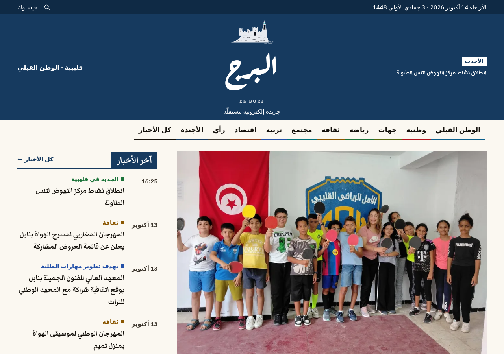
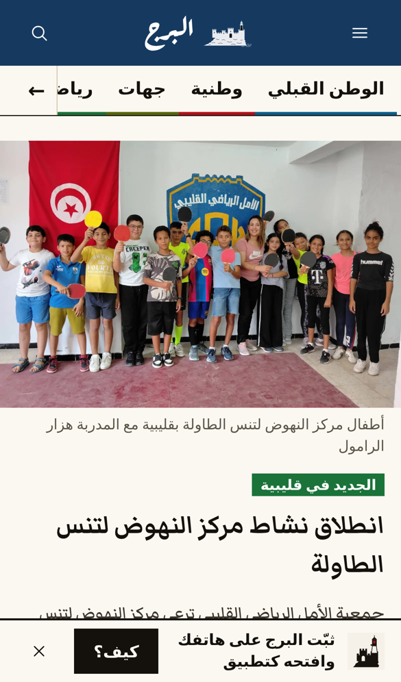
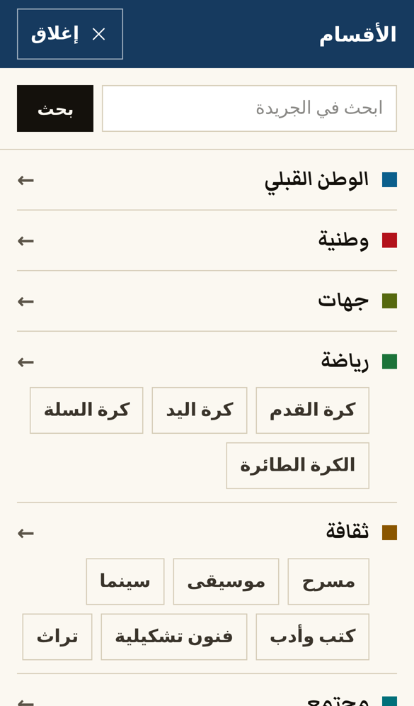
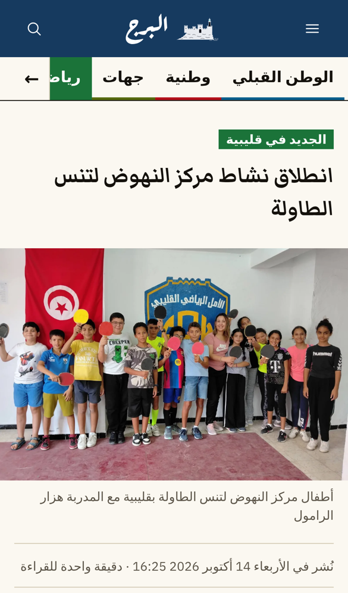

# البرج · El Borj — online newspaper

Arabic online newspaper (RTL) from Kelibia for Mourad Ridene: public site, admin/CMS (in French),
first-party statistics that nobody can edit, sponsor ads and a live media kit. Next.js on
Cloudflare Workers + Supabase.

**Live: https://borj.tn** · admin at https://borj.tn/fr/admin/login · contact@borj.tn

- The newspaper is **Arabic only**; `/fr/*` reader pages redirect to `/ar/*`. The admin is **French only** (`/ar/admin` redirects to `/fr/admin`).
- `www.borj.tn` and the old test address `www.elborj.workers.dev` redirect to `borj.tn`.
- Built for older readers on phones: navy masthead, one colour per section (editable in the admin), large text and tap targets.

## Screenshots

Live site, 2026-10-14 (`docs/screenshots/live-2026-10-14/`).

| Homepage (desktop) |
|---|
|  |

| Homepage (phone) | Menu (phone) | Article (phone) |
|---|---|---|
|  |  |  |

| Article editor (admin) | Statistics (admin, simulated local traffic) |
|---|---|
|  |  |

Admin screens are from the build (`docs/screenshots/phase*/`, before the admin became French only).
Facebook page pictures and the «البرج في حلّة جديدة» poster: `design/facebook/*-2026.*`.

## Start here

| You want to… | Read |
|---|---|
| Put it online | `supabase/APPLY.md` (database), then `docs/DEPLOY.md` (Cloudflare) |
| Move to the $5 Cloudflare plan | `docs/WORKERS-PAID.md` (what to switch back in the code) |
| Launch it | `docs/LAUNCH.md` |
| Know what was built and what's left for you | `docs/PROGRESS.md` (ends with "What Firas needs to do") |
| Know why things are the way they are | `docs/DECISIONS.md` |
| Continue development with Claude Code | `CLAUDE.md`, `docs/HANDOFF.md`, and the `MODULE.md` in each folder (`supabase/MODULE.md` = the database) |

## Run it locally

Needs Node 22 and pnpm 10.

**Against the online Supabase project** (simplest; what Firas uses): copy `.env.example`
to `.env.local`, fill in the project URL, anon/publishable key, secret key and two random
strings (`openssl rand -hex 32`), then `pnpm install && pnpm dev`. Don't run
`pnpm test:db` or `pnpm dev:traffic` against it (they reset or fake statistics).

**With a local database** (needs Docker; required for `pnpm test:db` and the e2e tests):

```bash
pnpm install
npx supabase start                 # local database; prints the local keys
cp .env.example .env.local         # put the local URL/keys in it (see docs/HANDOFF.md)
pnpm db:local-reset                # migrations + seed + demo content + 3 test users
pnpm dev:traffic                   # optional: 45 days of simulated readers (local only)
pnpm dev                           # http://localhost:3000  — admin: /fr/admin/login
```

Test users (local only): `admin@elborj.test`, `editor@elborj.test`, `author@elborj.test`,
password `local-dev-password`.

## Commands

| Command | What it does |
|---|---|
| `pnpm lint` / `pnpm typecheck` / `pnpm test` | ESLint (incl. RTL rule), TypeScript, unit tests |
| `pnpm test:db` | SQL tests against the local database (RLS, statistics lock, rollups…) |
| `pnpm build && pnpm start` then `E2E_NO_SERVER=1 pnpm test:e2e` | Playwright end-to-end tests |
| `pnpm db:bundle` | Rebuilds `supabase/ALL_MIGRATIONS.sql` from the numbered migrations |
| `pnpm db:demo` | Regenerates `supabase/demo-seed.sql` |
| `pnpm build:cf` / `pnpm bundle:size` | Cloudflare build, Worker size check (now 1.69 MiB gzip; limit 3 MiB free / 10 MiB paid) |
| `pnpm run deploy` | Build without local secrets and deploy (`scripts/deploy.sh`; not `pnpm deploy`, which is a pnpm built-in). If Wrangler's login expired, run `npx wrangler login` first |
| `node design/facebook/render-2026.mjs [phone]` | Re-render the Facebook pictures and poster (`phone` refreshes the site screenshot in the poster) |
| `bash scripts/backup.sh` | Database backup (see DEPLOY.md §8) |
| `bash scripts/lighthouse-median.sh <url>` | Lighthouse mobile, median of 3 runs |

## Costs

- Cloudflare **Workers Paid** since 2026-10-03: $5/month. Supabase free plan: 0. Domain `borj.tn`: yearly fee.

## Upgrade path (only when needed)

| Sign | Upgrade | Cost (list prices when written; check before buying) |
|---|---|---|
| ~~More than ~100k page requests a day, error 1102~~ | Cloudflare **Workers Paid**: done 2026-10-03 (`docs/WORKERS-PAID.md`) | $5/month |
| Database near 500 MB, storage near 1 GB, need real backups or no pausing | **Supabase Pro** (8 GB DB, 100 GB storage, daily backups, no pausing) | $25/month |
| Login e-mails limited | A free SMTP provider in Supabase Auth (no upgrade needed) | free |
| Error alerts wanted | Sentry free tier | free |

Nothing in the code has to change for these upgrades; `docs/WORKERS-PAID.md` lists optional improvements once on Workers Paid.

## Things to confirm with your dad (can be changed later in the admin, no code)

- [x] Name of the paper: «البرج» / El Borj
- [x] Domain: borj.tn · contact email: contact@borj.tn
- [ ] Tagline (now «جريدة إلكترونية مستقلّة»)
- [ ] Section list and colours (admin → Rubriques)
- [ ] Is «أبو فراس» still a signature he wants to use? (can be a byline override)
- [ ] Legal masthead: who is المدير المسؤول and رئيس التحرير, address, phone (articles are unsigned until this is settled, DECISIONS.md → "Bylines and names")
- [ ] Whether the publication needs to be declared anywhere in Tunisia (ask SNJT or a lawyer)

## What's in `docs/`

| File | Content |
|---|---|
| 01-product.md | Vision, positioning, roles, scope |
| 02-design-system.md | Visual direction from the research, tokens, fonts, components, banned "AI look" patterns (colour rules updated 2026-10-14) |
| 03-architecture.md | Stack, Cloudflare/OpenNext, i18n, caching, media, auth, security |
| 04-database.md | Full schema, seed data, RLS, cron jobs, migration deliverables |
| 05-public-site.md | Every public page |
| 06-admin-cms.md | Every admin screen, including categories and homepage builder |
| 07-analytics-and-monetization.md | Tracker, dashboards, per-author stats, GA4, AdSense, sponsors, media kit |
| 08-seo-legal-ops.md | SEO, feeds, legal pages, deployment, backups, launch checklist |
| 09-build-plan.md | Phases, checks, stop points |
| DEPLOY.md, WORKERS-PAID.md, LAUNCH.md | Deploying, the $5 plan, launch checklist |
| HANDOFF.md, PROGRESS.md, DECISIONS.md | Current state, what was built, why |
| research/tunisian-press-notes.md | What Tunisian news sites look like, and what we keep or avoid |
